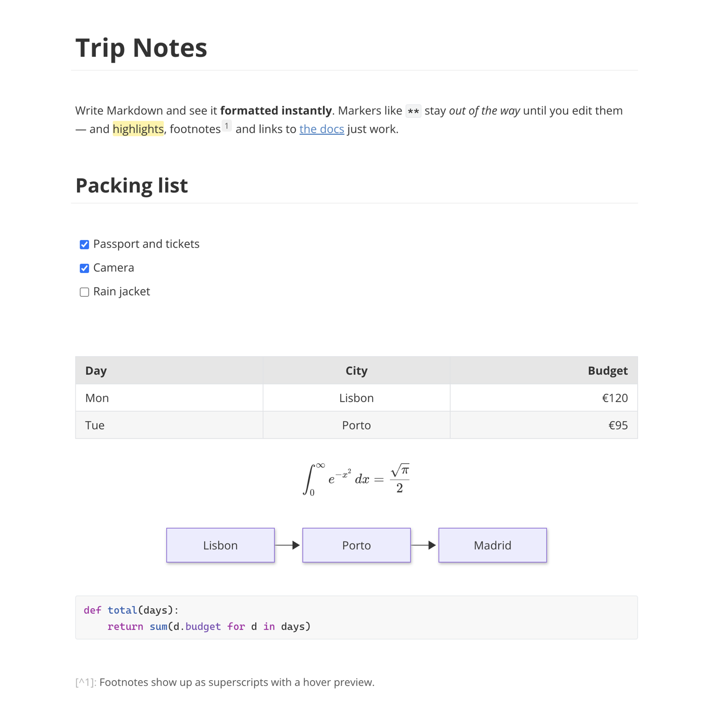

<p align="center">
  
</p>

<h1 align="center">Nib</h1>

<p align="center">
  <strong>A free, open-source WYSIWYG Markdown editor for macOS and Windows.</strong><br>
  Type Markdown and see it formatted instantly. No account, no cloud, no tracking — just your <code>.md</code> files.
</p>

<p align="center">
  <a href="https://github.com/colinder/Nib/releases/latest"><strong>Download</strong></a> ·
  <a href="#features">Features</a> ·
  <a href="#keyboard-shortcuts">Shortcuts</a> ·
  <a href="#build-from-source">Build from source</a> ·
  <a href="#한국어">한국어</a>
</p>

<p align="center">
  
</p>

## Why Nib?

Most Markdown editors split the screen into "source" and "preview". Nib doesn't: you write in a single, clean page and each element is rendered **as soon as its syntax is complete** — `**bold**` turns bold the moment you type the closing `**`, `# ` becomes a heading the moment you type the space. Markers only reappear while your cursor is inside that element, so you can always edit the raw Markdown without switching modes.

- **Live preview, one pane** — a distraction-free, seamless writing experience.
- **Your files stay plain Markdown** — Nib never rewrites what you didn't touch. Opening and saving a file leaves it byte-for-byte identical, including LF/CRLF line endings.
- **Local and private** — works fully offline, needs no account, and sends no telemetry.
- **Built for every language** — careful handling of IME input (Korean, Japanese, Chinese) so composing text never jumps or disappears.
- **Free and open source** — MIT licensed.

## Features

| | |
|---|---|
| **Formatting** | Headings, **bold**, *italic*, ~~strikethrough~~, `inline code`, links, <u>underline</u>, ==highlight==, superscript `x^2^`, subscript `H~2~O` |
| **Lists** | Bullet, numbered and nested lists, task lists with clickable checkboxes, smart `Tab` / `Shift+Tab` indentation with automatic renumbering |
| **Tables** | Edit cells directly, add/move/delete rows and columns, column alignment, resize — or just type `\|a\|b\|` and press Enter |
| **Images** | Inline rendering, drag & drop to insert, drag the corner to resize (``), relative paths resolved from the document's folder |
| **Code blocks** | Syntax highlighting for 100+ languages, language picker with icons, auto-closing fences |
| **Math** | KaTeX inline `$...$` and block `$$...$$` formulas with live preview and error messages, chemistry via `\ce{}` (mhchem) |
| **Diagrams** | Mermaid flowcharts, sequence, state, class, ER, Gantt and pie charts, rendered in place |
| **Footnotes** | `[^1]` references shown as superscripts with hover previews; missing definitions are flagged |
| **Windows & files** | One window per document, open/save/save as, unsaved-change indicator, atomic saves |
| **Fonts** | Choose body and code fonts (Open Sans, Pretendard, Cascadia Code or system fonts) — bundled, so they work offline |
| **Theme** | Light and dark, following your system setting |
| **Help** | Press `F1` for a built-in guide to every shortcut and input rule |

## Download

Get the latest version from the **[Releases page](https://github.com/colinder/Nib/releases/latest)**.

| Platform | File |
|---|---|
| macOS — Apple Silicon (M1/M2/M3/M4) | `Nib-<version>-arm64.dmg` |
| macOS — Intel | `Nib-<version>.dmg` |
| Windows 10 / 11 (64-bit) | `Nib-Setup-<version>.exe` |

### Install

- **macOS**: open the `.dmg` and drag **Nib** into **Applications**. The app is signed and notarized by Apple, so it opens without security warnings.
- **Windows**: run `Nib-Setup-<version>.exe`. The installer is not code-signed yet, so Windows SmartScreen may show a warning — click **More info → Run anyway**.

> Linux is not officially supported yet.

### Uninstall

Your documents are never stored inside the app, so removing Nib's data does not affect your files.

- **Windows**: uninstall Nib from **Settings → Apps**. App data (`%APPDATA%\Nib`) is removed automatically.
- **macOS**: move Nib to the Trash, then remove its settings and cache:

  ```sh
  rm -rf ~/Library/Application\ Support/Nib ~/Library/Preferences/io.github.colinder.nib.plist
  ```

## Keyboard shortcuts

`Mod` is `⌘` on macOS and `Ctrl` on Windows. Press `F1` in the app for the full list.

| Action | Shortcut |
|---|---|
| New / Open / Save / Save as | `Mod+N` / `Mod+O` / `Mod+S` / `Mod+Shift+S` |
| Bold / Italic / Underline | `Mod+B` / `Mod+I` / `Mod+U` |
| Strikethrough / Highlight / Inline code | `Mod+Shift+X` / `Mod+Shift+H` / ``Mod+Shift+` `` |
| Insert link | `Mod+K` |
| Heading 1–6 / Paragraph | `Mod+1` … `Mod+6` / `Mod+0` |
| Quote / Bullet list / Numbered list | `Mod+Alt+Q` / `Mod+Alt+U` / `Mod+Alt+O` |
| Code block / Math block / Table | `Mod+Alt+C` / `Mod+Alt+B` / `Mod+Alt+T` |
| Indent / Outdent list item | `Tab` / `Shift+Tab` |
| Line break within a paragraph | `Shift+Enter` |
| Open link | `Mod+Click` |
| Settings / Help | `Mod+,` / `F1` |

## Markdown input rules

Type plain Markdown — Nib formats it as you go.

| Type | Result |
|---|---|
| `# ` … `###### ` | Heading 1–6 |
| `- ` `* ` `+ ` / `1. ` | Bullet / numbered list |
| `- [ ] ` | Task list item |
| `> ` | Blockquote |
| `---` | Horizontal rule |
| ` ``` ` + language + Enter | Code block |
| `$$` + Enter | Math block |
| `\|Name\|Value\|` + Enter | Table |
| `[^1]` and `[^1]: note` | Footnote |

A sample document with math, diagrams and footnotes lives in [`docs/samples/math-and-diagrams.md`](docs/samples/math-and-diagrams.md).

## Build from source

Requirements: Node.js 24 and npm 11.

```sh
git clone https://github.com/colinder/Nib.git
cd Nib
npm install
npm run dev        # run in development mode
npm test           # run tests
npm run typecheck  # type-check
```

Build installers (output in `dist/`):

```sh
npm run dist:mac   # .dmg for Apple Silicon and Intel
npm run dist:win   # NSIS .exe for Windows x64
```

macOS builds are signed with the Developer ID certificate in your keychain. To notarize, store credentials once with `xcrun notarytool store-credentials "nib-notary"`, then run `APPLE_KEYCHAIN_PROFILE=nib-notary npm run dist:mac`.

### Tech stack

| Area | Choice |
|---|---|
| Shell | Electron |
| UI | React + TypeScript |
| Editor engine | CodeMirror 6 (live preview via decorations) |
| Math / diagrams | KaTeX, Mermaid |
| Build | electron-vite, electron-builder |
| Tests | Node.js built-in test runner (`node --test`) |

Design documents (in Korean): [Product spec](docs/PRODUCT_SPEC.md) · [Technical design](docs/TECHNICAL_DESIGN.md) · [Roadmap](docs/ROADMAP.md)

## Contributing

Bug reports and feature requests are welcome on the [Issues page](https://github.com/colinder/Nib/issues). When reporting a bug, please include your OS, Nib version, and the Markdown that reproduces it.

## License

[MIT](LICENSE) © colinder

Code block language icons are from [vscode-icons](https://github.com/vscode-icons/vscode-icons) (MIT). Bundled fonts — Open Sans, Pretendard and Cascadia Code — are licensed under the SIL Open Font License.

---

## 한국어

**Nib**은 macOS와 Windows용 **무료 오픈소스 WYSIWYG 마크다운 에디터**입니다. 마크다운을 입력하는 즉시 서식이 적용되고, 편집 중인 요소에만 원문 기호가 드러나 화면 하나로 글쓰기에 집중할 수 있습니다.

- **실시간 미리보기**: 미리보기 창을 따로 띄우지 않고 한 화면에서 바로 렌더링
- **원문 그대로 저장**: 손대지 않은 부분은 바뀌지 않고, 줄바꿈(LF/CRLF)도 유지
- **한글 입력 최적화**: 한글 조합 중 글자가 튀거나 사라지지 않도록 다듬음
- **표·이미지·코드 블록·KaTeX 수식·Mermaid 다이어그램·각주** 지원
- **오프라인·무계정·무추적**, MIT 라이선스

**다운로드**: [Releases 페이지](https://github.com/colinder/Nib/releases/latest)에서 macOS(`.dmg`, Apple Silicon/Intel)와 Windows(`.exe`) 설치 파일을 받을 수 있습니다. macOS 앱은 Apple 공증을 받아 경고 없이 열립니다. Windows에서 SmartScreen 경고가 뜨면 **추가 정보 → 실행**을 누르세요.

앱 안에서 `F1`을 누르면 모든 단축키와 입력 규칙을 한국어로 볼 수 있습니다.
