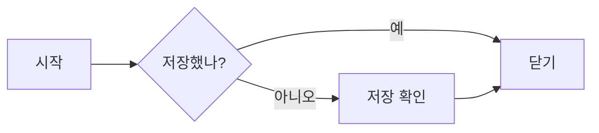
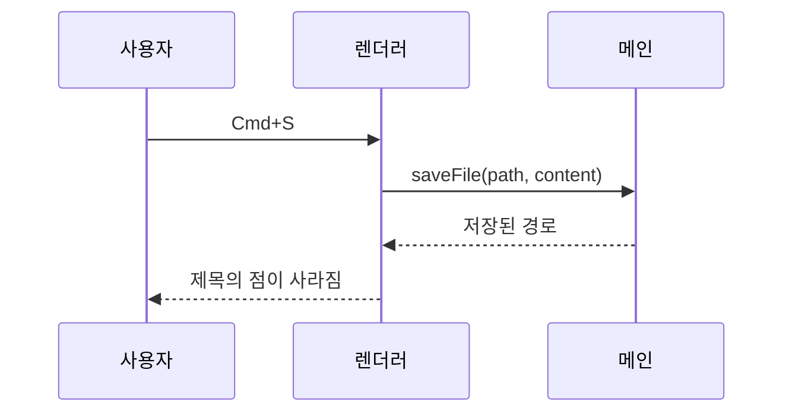
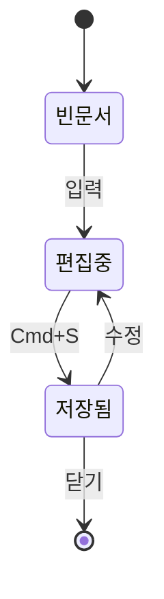
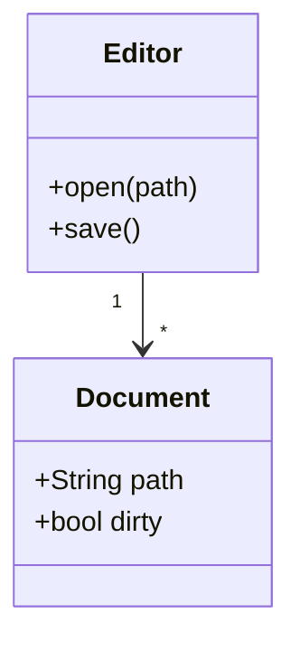
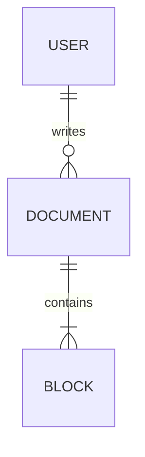
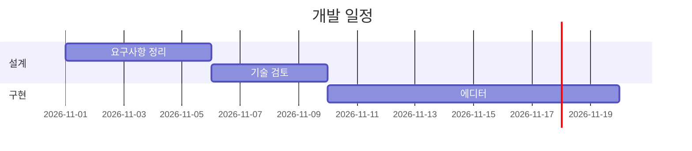
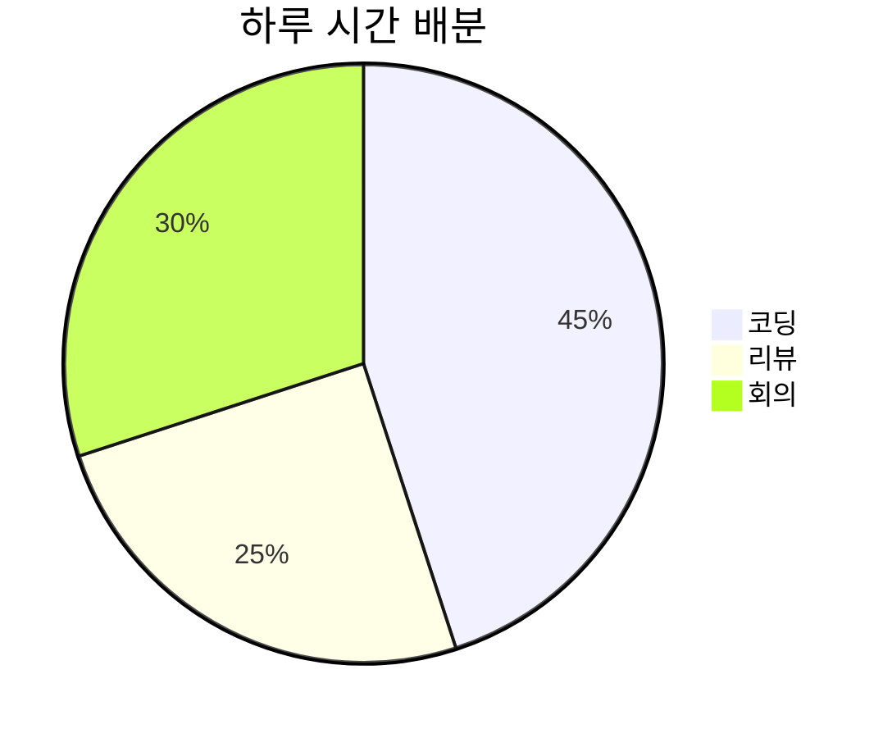

# 수식과 다이어그램 샘플

Nib에서 수식(KaTeX), 다이어그램(Mermaid), 각주가 어떻게 보이는지 확인하는 문서입니다.[^1]
커서를 수식이나 다이어그램 안으로 옮기면 원문과 미리보기가 함께 보이고, 밖으로 나오면 결과만 보입니다.

## 1. 인라인 수식

- 피타고라스 정리: $a^2 + b^2 = c^2$
- 오일러 등식: $e^{i\pi} + 1 = 0$
- 이차방정식의 해: $x = \frac{-b \pm \sqrt{b^2 - 4ac}}{2a}$
- 합과 극한: $\sum_{k=1}^{n} k = \frac{n(n+1)}{2}$, $\lim_{x \to 0} \frac{\sin x}{x} = 1$
- 가격 $5 와 $6 은 수식이 아니라 그냥 글자입니다.

## 2. 블록 수식

가우스 적분:

$$
\int_{-\infty}^{\infty} e^{-x^2}\,dx = \sqrt{\pi}
$$

맥스웰 방정식 (정렬):

$$
\begin{aligned}
\nabla \cdot \mathbf{E} &= \frac{\rho}{\varepsilon_0} \\
\nabla \cdot \mathbf{B} &= 0 \\
\nabla \times \mathbf{E} &= -\frac{\partial \mathbf{B}}{\partial t} \\
\nabla \times \mathbf{B} &= \mu_0 \mathbf{J} + \mu_0 \varepsilon_0 \frac{\partial \mathbf{E}}{\partial t}
\end{aligned}
$$

행렬과 조건식:

$$
A = \begin{pmatrix} a & b \\ c & d \end{pmatrix}, \qquad
f(x) = \begin{cases}
x^2 & (x \ge 0) \\
-x & (x < 0)
\end{cases}
$$

## 3. 화학식

인라인: 탄산 생성은 $\ce{CO2 + H2O <=> H2CO3}$ 입니다.

블록:

$$
\ce{2H2 + O2 -> 2H2O}
$$

$$
\ce{SO4^2- + Ba^2+ -> BaSO4 v}
$$

## 4. 다이어그램

### 순서도

### 시퀀스 다이어그램

### 상태 다이어그램

### 클래스 다이어그램

### ER 다이어그램

### 간트 차트

### 원 그래프

## 5. 각주

각주는 위첨자로 보이고 마우스를 올리면 내용이 뜹니다.[^2] 정의가 없는 각주[^3]는 빨간색으로 표시됩니다.

[^1]: 수식은 KaTeX, 다이어그램은 Mermaid로 그립니다. 둘 다 앱에 포함되어 있어 오프라인에서도 동작합니다.
[^2]: 각주 정의는 문서 어디에 있어도 됩니다. 지금은 한 줄짜리 정의만 지원합니다.
